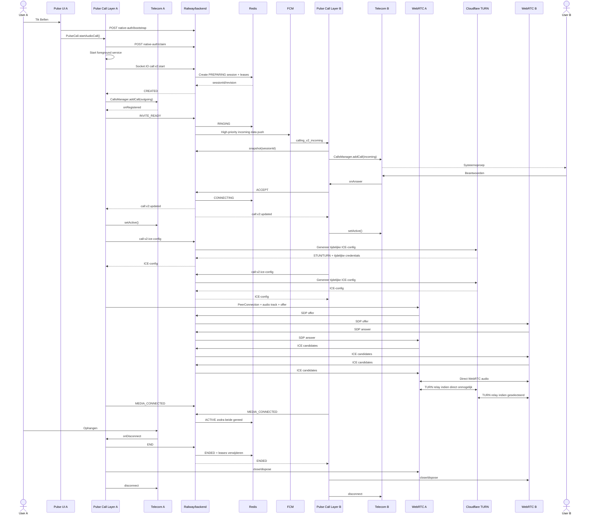

# Pulse audiobellen: technische analyse

## Onderzoeksbasis

Onderzocht zonder codewijzigingen, builds of commits:

- Frontend/Android: `bde6e6f837d2d76c2df9f6c24aaa66bfea823b54`
- Backend: `2839511ba81ac6d38461411f3f58bd27c1b4783c`
- Beide werkbomen waren tijdens het onderzoek schoon.
- Huidige Android-build: `versionCode 58`.
- Video is momenteel expliciet uitgeschakeld; dit rapport beschrijft de actuele audioflow.

## 1. Android-onderdelen

| Bestand/class | Functie | Aangeroepen door | Roept aan / rol |
|---|---|---|---|
| `src/components/ChatHeader.js`, `ChatSidebar.js`, `ChatModals.js` | Toont belknoppen | Gebruiker | Roept `handleStartAudioCall` aan |
| `src/screens/ChatScreen.js` | Selecteert contact en blokkeert dubbele taps | UI-knoppen | Roept `startNativeAudioCall` aan |
| `src/services/nativeCall.js` | Firebase-bootstrap en Capacitor-bridge | `ChatScreen` | REST-bootstrap en `PulseCall.startAudioCall()` |
| `PulseCallPlugin.java` | Microfoonpermissie, native authenticatie en start service | Capacitor | Claimt Firebase-token en start `PulseCallService` |
| `PulseCallService.kt` | Foreground service en samenstelling call-stack | Plugin of FCM | Orchestrator, Telecom, signaling, WebRTC en notificatie |
| `PulseCallSessionOrchestrator.kt` | Centrale uitvoering uitgaand/inkomend gesprek | Service | Railway, coordinator, Telecom en media |
| `PulseCallCoordinator.kt` | Lokale call-state als `StateFlow` | Orchestrator | Verzoent Telecom-, media- en serverstatus |
| `PulseCallStateMachine.java` | `IDLE -> PREPARING -> RINGING -> CONNECTING -> ACTIVE -> ENDING -> ENDED` | Coordinator | Zuivere state transitions |
| `CoreTelecomController.kt` | Jetpack Core-Telecom-integratie | Orchestrator | `CallsManager.registerAppWithTelecom()` en `addCall()` |
| `RailwayCallSignalingClient.kt` | Socket.IO-client | Orchestrator/media | Start, commando's, snapshots, SDP en ICE |
| `PulseCallMediaSessionController.kt` | Media lifecycle en buffering | Orchestrator | Haalt ICE-config op en bestuurt WebRTC-engine |
| `WebRtcAudioEngine.kt` | Microfoon, audiotrack, PeerConnection, SDP en ICE | Media-controller | WebRTC SDK |
| `PulseIceCandidateBuffer` | Buffert ICE tot remote SDP is ingesteld | WebRTC-engine | Maximaal 128 candidates |
| `PulseMessagingService.kt` | Ontvangt incoming-call FCM | Firebase | Start inkomende `PulseCallService` |
| `PulseNetworkMonitor.kt` | Detecteert wisseling standaardnetwerk | Service | Vraagt `NETWORK_LOST` en ICE restart aan |
| `AndroidManifest.xml` | Registreert service en permissies | Android | Foreground service `phoneCall|microphone` en FCM-service |

Manifestpermissies: `INTERNET`, `ACCESS_NETWORK_STATE`, `POST_NOTIFICATIONS`, `VIBRATE`, `MANAGE_OWN_CALLS`, `RECORD_AUDIO`, `FOREGROUND_SERVICE`, `FOREGROUND_SERVICE_PHONE_CALL` en `FOREGROUND_SERVICE_MICROPHONE`. Er is geen `CAMERA`- of Bluetooth-permissie.

## 2. Uitgaande audiocall

1. A tikt een belknop. `ChatScreen.handleStartAudioCall()` controleert dubbele taps, groepen en blokkades.
2. `startNativeAudioCall()` vraagt via `POST /api/calling/v2/native-auth/bootstrap` een eenmalige Redis-code aan en maakt lokaal een `requestId`.
3. `PulseCallPlugin.startAudioCall()` vraagt zo nodig `RECORD_AUDIO`.
4. De plugin claimt de code via `POST /api/calling/v2/native-auth/claim` en meldt native Firebase Auth aan met het ontvangen custom token.
5. De plugin accepteert alleen lokale status `IDLE/ENDED` en start `PulseCallService` als foreground service.
6. De service toont onmiddellijk een blijvende `phoneCall`-notificatie. Het microfoontype wordt pas toegevoegd vlak voor media-start.
7. `startOutgoing()` vraagt een Firebase ID-token op en verbindt `RailwayCallSignalingClient` met `https://api.pulse-messenger.com`.
8. Socket.IO verstuurt `call:v2:start {requestId, calleeUid, mediaType: "audio"}`.
9. Backend `src/socket/calling.v2.js` controleert dat B een toegestaan contact is.
10. `CallV2Service.start()` maakt nu pas de echte `sessionId` met `randomUUID()`.
11. Redis maakt atomisch een `PREPARING`-sessie, leases voor A/B en een request-deduplicatiesleutel.
12. Android A slaat die sessie op in de coordinator en registreert hem via Core-Telecom `CallsManager.addCall()`.
13. Zodra Telecom registreert, stuurt A `INVITE_READY`; Railway verandert Redis-status naar `RINGING`.
14. Railway emit `call:v2:updated` naar beide gebruikers en verstuurt een high-priority data-only FCM naar B.
15. De foreground-notificatie gebruikt aanvankelijk `requestId`; na serveracceptatie wordt de server-`sessionId` gebruikt.

## 3. Inkomende audiocall

1. De betrouwbare wake-up voor B is FCM-data `{type: "calling_v2_incoming", protocolVersion: "2", sessionId}` uit `src/push.js`. Een Socket.IO-update wordt ook geëmit, maar de native B-callclient is voor de wake-up normaal nog niet actief.
2. `PulseMessagingService.onMessageReceived()` valideert het bericht, vereist een bestaande native Firebase-gebruiker en start `PulseCallService`.
3. `registerIncoming()` verbindt met Railway en vraagt `call:v2:snapshot` op.
4. Alleen wanneer B werkelijk `calleeUid` is en de serverstatus `RINGING` is, roept de orchestrator `CallsManager.addCall()` aan als incoming audio call.
5. Android Telecom toont en beheert de systeemoproep. Er is geen eigen inkomende-call-Activity.
6. Opnemen levert `onAnswer()` op; Pulse stuurt `ACCEPT`. Weigeren/disconnect tijdens `RINGING` wordt `DECLINE`; later ophangen wordt `END`.
7. Railway zet de status op `CONNECTING` en informeert A en B.
8. Beide clients roepen Telecom `setActive()` aan en starten daarna pas WebRTC.
9. Wanneer beide clients `MEDIA_CONNECTED` hebben gemeld, zet de backend de sessie op `ACTIVE`.

## 4. Cloudflare

1. **Gaat signaling via Cloudflare?** De code gebruikt rechtstreeks de Railway/API-host. Er is geen Worker of Durable Object voor calls. Of `api.pulse-messenger.com` buiten deze repositories door Cloudflare wordt geproxied: **NIET VAST TE STELLEN VANUIT HUIDIGE CODEBASE**. Daarvoor is DNS/proxyconfiguratie van het beherende zone-account nodig.
2. **Welke call-events passeren Cloudflare?** Aantoonbaar alleen de backendaanvraag voor tijdelijke TURN/STUN-gegevens en conditioneel WebRTC-relaymedia. `START`, `ACCEPT`, SDP en ICE gaan applicatief via Railway.
3. **WebSockets via Cloudflare?** **NIET VAST TE STELLEN VANUIT HUIDIGE CODEBASE**. De client opent Socket.IO naar `api.pulse-messenger.com`; de externe DNS-route is niet in Git vastgelegd.
4. **Audio via Cloudflare?** Alleen wanneer WebRTC een `relay`-candidate kiest. Bij directe `host/srflx`-verbinding niet.
5. **STUN/TURN?** Ja. Backend `src/calling/v2/turnCredentials.js` vraagt dynamische ICE-servers op bij Cloudflare TURN.
6. **Call zonder Cloudflare?** Signaling kan beginnen, maar een nieuwe audiocall kan in de huidige client niet tot media komen: de media-controller stopt wanneer de ICE-config ontbreekt. Een reeds verbonden directe call kan in beginsel doorlopen; dat runtimegedrag is niet expliciet gecodeerd.
7. **Relevante configuratie:** `CLOUDFLARE_TURN_KEY_ID`, `CLOUDFLARE_TURN_KEY_SECRET`, `CLOUDFLARE_TURN_TTL_SECONDS`; default TTL 7200 seconden. Het gekoppelde Cloudflare-account retourneerde tijdens deze audit nul TURN keys. Of Railway naar een sleutel uit een ander account of een verwijderde sleutel verwijst: **NIET VAST TE STELLEN VANUIT HUIDIGE CODEBASE**.

Cloudflare Pages host de webclient, maar speelt geen directe rol in de native call lifecycle.

## 5. Railway/backend

| Vraag | Huidige implementatie |
|---|---|
| Services op Railway | Repo definieert een Node/Express/Socket.IO-service via `railway.toml`. De volledige live service-inventaris is **NIET VAST TE STELLEN VANUIT HUIDIGE CODEBASE**. |
| Betrokken diensten | Node-backend en Redis; PostgreSQL uitsluitend als alternatieve contactautorisatie |
| Call signaling | Ja, Socket.IO |
| Invite/accept/reject/hangup | `INVITE_READY`, `ACCEPT`, `DECLINE`, `END`, plus `FAIL`, `NETWORK_LOST`, `MEDIA_CONNECTED` |
| Offer/answer | Ongewijzigd doorgestuurd via `call:v2:media` |
| ICE candidates | Ongewijzigd doorgestuurd via hetzelfde event |
| Actieve calls | Serverstatus staat in Redis |
| Redis | Verplicht voor Calling v2; zonder Redis faalt het gesloten |
| PostgreSQL | Geen call-state of media; alleen contactcontrole via `native_contacts/native_blocked_contacts` |
| Audio door Railway | Nee. Alleen signaling; RTP/audio loopt direct of via Cloudflare TURN |

**Control plane:** Railway Node + Socket.IO + Redis + FCM.

**Media plane:** WebRTC tussen A/B, eventueel gerelayeerd door Cloudflare TURN.

Of `PULSE_CALLING_V2_ENABLED=true` en de TURN-variabelen momenteel in live Railway staan: **NIET VAST TE STELLEN VANUIT HUIDIGE CODEBASE**. Daarvoor zijn de Railway deploymentvariabelen nodig.

## 6. WebRTC-lifecycle

`PulseCallMediaSessionController.start()` haalt eerst via Railway `call:v2:ice-config` op. Daarna maakt `WebRtcAudioEngine.start()` `JavaAudioDeviceModule`, `PeerConnectionFactory`, `AudioSource`, een ingeschakelde lokale `AudioTrack` en een Unified-Plan `PeerConnection`.

A is `OFFERER`: `createOffer()` -> `setLocalDescription()` -> Railway `call:v2:media`. B buffert zo nodig het signaal, doet `setRemoteDescription()` -> `createAnswer()` -> `setLocalDescription()` -> Railway -> A `setRemoteDescription()`. Lokale ICE candidates gaan eveneens via Railway. Remote candidates worden pas na remote SDP toegevoegd.

`IceConnectionState.CONNECTED/COMPLETED` of `PeerConnectionState.CONNECTED` meldt lokaal media-connected. `DISCONNECTED` veroorzaakt herstel; `FAILED` beëindigt met mediafout. Cleanup sluit/disposed PeerConnection, track, source, factory en audiomodule.

## 7. STUN/TURN

- Exacte STUN- en TURN-URL's: **NIET VAST TE STELLEN VANUIT HUIDIGE CODEBASE**. Ze worden per gesprek dynamisch door Cloudflare teruggegeven.
- Backend accepteert uitsluitend `stun:`, `turn:` en `turns:` URL's, weigert poort 53 en vereist minstens één TURN-server met credentials.
- Credentials zijn tijdelijk en dynamisch; permanente Cloudflare key-id/secret blijven uitsluitend op de backend.
- Railway haalt de configuratie bij Cloudflare op en geeft deze aan de geautoriseerde deelnemer door.
- Als directe P2P niet lukt, kan ICE een Cloudflare relay-candidate selecteren. De code forceert niet `relay-only`; direct, server-reflexive en relay zijn toegestaan.

## 8. Android Telecom

Pulse gebruikt Jetpack `androidx.core.telecom.CallsManager`, niet een eigen `ConnectionService`, `Connection` of expliciete `PhoneAccount`. `registerAppWithTelecom(CAPABILITY_BASELINE)` registreert de app; `addCall()` levert `CallControlScope`.

Telecomcallbacks zijn `onAnswer`, `onDisconnect`, `onSetActive` en `onSetInactive`. Telecom beheert OS-call lifecycle en systeem-UI; WebRTC beheert audio. Bij `CONNECTING` roept Pulse eerst `CallControlScope.setActive()` aan en start daarna WebRTC. Telecom-active betekent daarom nog niet dat audio verbonden is. De backend bepaalt `ACTIVE` nadat beide gebruikers `MEDIA_CONNECTED` hebben gemeld; de lokale coordinator neemt die serverstatus over.

## 9. Audio en routing

Microfoonopname en afspelen worden uitgevoerd door WebRTC `JavaAudioDeviceModule`; hardware echo cancellation en noise suppression staan aan. De remote audiotrack wordt in `onTrack()` ingeschakeld.

Er is in de huidige Pulse-code geen gebruik van `AudioManager`, `MODE_IN_COMMUNICATION`, audio focus, speakerphone, `setCommunicationDevice`, Bluetooth SCO, wired-headsetdetectie of een eigen routekiezer. De exacte keuze tussen speaker, earpiece, Bluetooth en kabelheadset is daarom **NIET VAST TE STELLEN VANUIT HUIDIGE CODEBASE**; Pulse laat dit aan WebRTC/Core-Telecom/Android over.

`setMuted()` bestaat en schakelt de lokale `AudioTrack` uit, maar wordt nergens vanuit productiecode aangeroepen. Er is dus geen aangesloten mute-flow gevonden.

## 10. Call-state

- **Redis/server:** gezaghebbende gedeelde sessie, revision, deelnemers, media-ready en terminal reason.
- **`PulseCallCoordinator.StateFlow`:** lokale samengevoegde lifecycle.
- **`PulseCallStateMachine`:** lokale deterministische status.
- **Orchestrator atomics:** server snapshot, identiteit, terminating en netwerkherstel.
- **Core-Telecom:** eigen OS-callstatus en actieve `CallControlScope`.
- **WebRTC `StateFlow`:** `NEW/STARTING/NEGOTIATING/CONNECTED/RECONNECTING/FAILED/CLOSED`.
- **Socketclient:** connectiestatus en actieve `sessionId`.
- **Service:** foreground-call-id, notificatie en netwerkmonitor.
- **React:** alleen `callLaunchPending` en capabilities; geen volledige callstatus.

Er is geen universele enkele state-store. Redis is source of truth voor de gedeelde sessie; coordinator, Telecom en WebRTC zijn afzonderlijke lokale sources of truth voor hun eigen domein.

## 11. Sequence diagram

## 12. Eenvoudige uitleg

A drukt op bellen. Pulse maakt eerst veilig een native identiteit aan en vraagt Railway om een nieuwe gesprekssessie. Railway bewaart die sessie in Redis. Daarna registreert Pulse de oproep bij Android Telecom. Zodra Telecom klaarstaat, stuurt Railway via FCM een inkomende oproep naar B.

B neemt op via de Android-systeemoproep. Railway registreert de acceptatie en beide telefoons starten WebRTC. Railway vervoert de offer, answer en ICE-candidates. Cloudflare levert tijdelijke STUN/TURN-informatie en vervoert alleen audio wanneer een directe telefoon-naar-telefoonverbinding niet lukt. Railway zelf vervoert geen audio. Wanneer WebRTC aan beide kanten verbonden is, markeert Railway de sessie als actief.

## 13. Componententabel

| Component | Rol | Signaling? | Audio/media? | Nodig tijdens gesprek? |
|---|---|---:|---:|---:|
| Android-app | Orchestratie, service, microfoon en WebRTC | Ja | Ja | Ja |
| Android Telecom | OS-oproepstatus en systeem-UI | Callbackbesturing | Nee | Ja |
| Cloudflare | Dynamische ICE-config en conditionele TURN-relay | Alleen TURN-configrequest | Alleen bij relay | Conditioneel |
| Railway/backend | Sessies, Socket.IO, SDP/ICE-relay en pushtrigger | Ja | Nee | Ja voor state/signaling |
| Redis | Sessiestatus, leases, revisies en deduplicatie | Ja | Nee | Ja |
| PostgreSQL | Alternatieve contactautorisatie | Beperkt | Nee | Niet na autorisatie |
| Firestore/Firebase Auth | Identiteit, contacten en FCM-tokens | Ondersteunend | Nee | Auth/push |
| FCM | Maakt B wakker voor inkomende oproep | Alleen invite-wakeup | Nee | Alleen bij inkomend |
| WebRTC | PeerConnection en realtime audio | Genereert SDP/ICE | Ja | Ja |
| STUN | Ontdekt publiek netwerkpad | ICE | Nee | Tijdens ICE |
| TURN | Relay wanneer direct pad mislukt | ICE-config | Ja, conditioneel | Alleen bij relay |

---

Dit document beschrijft uitsluitend de aangetroffen implementatie. Tijdens het onderzoek zijn geen codewijzigingen, fixes, builds, AAB's of commits gemaakt.
